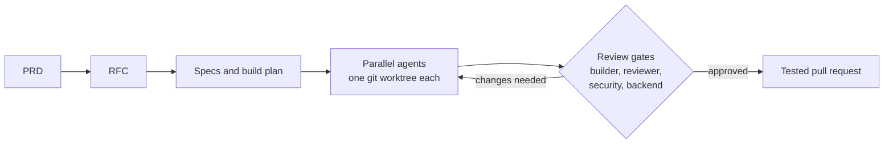

<h3 align="center">Backend + AI engineer · building multi-agent developer tools</h3>

## 💫 About Me

I'm a Computer Science undergraduate at **IIIT Nagpur** building intelligent systems at the intersection of **Backend Engineering, Computer Vision, Deep Learning, and AI Systems**.

💼 Currently: **AI Software Engineer Intern @ Testsigma** (see [Experience](#-experience))

🔥 **2,600+ contributions** on GitHub, 2,200+ of them in 2026 (as of Oct 2026)

🏆 **Meta PyTorch OpenEnv Hackathon 2026** Grand Finale finalist, selected from 52,000+ developers

🚪 **PRAVESH**, my campus gate system, is used by **1,000+ students** and won a [team award from the Director of IIIT Nagpur](https://drive.google.com/file/d/1mFaT00XQ3GksPhE4ODQIOOVK2w_XN7UI/view?usp=sharing)

🔬 My work focuses on **Multi-Agent AI Systems**, **Computer Vision**, **Image Forensics**, and **Data Engineering**

📚 I like going deep across fields, from AI agents and research to running fests and street theatre (see [Fields I Go Deep In](#-fields-i-go-deep-in))

🌱 Currently exploring **Agentic AI tooling**, **Generative Models**, and scalable AI system design while strengthening my foundations in **Data Structures & Algorithms**

⚡ Guiding principle: *“Persistence prevails when everything else fails.”*

---

## 💼 Experience

### 🧪 AI Software Engineer Intern — Testsigma · Bengaluru, Karnataka · Sep 2026 – Present

Building features for a test-automation platform across backend, frontend and production support.

- Debug production issues with **Datadog** and ship fixes behind feature flags, with automatic fallback and one-toggle rollback (**Java / Spring Boot**)
- Migrated **3 features across multiple services** from the legacy platform to a new test management product (**Go / GraphQL**, **Next.js / React**) by running **5+ Claude Code agents** in parallel: a dispatcher, builders in separate git worktrees, a reviewer, and security and backend critics, from written RFC to tested pull request
- Practise **agentic engineering** day to day: a skill pipeline that takes each feature from PRD to RFC, specs, test-first implementation and pull request, with review gates and budget guards so agent output is checked before it merges
- Keep changes safe to ship: unit and end-to-end tests, **Aikido** security scans on every pull request, and release and rollback plans for QA and DevOps

### 🌾 Agritech AI & Data Intern — GramIQ (SmartU Krishi)

Building AI and data features for a farmer app in 6 Indian languages: crop diagnosis, market prices and multilingual content.

- Built an AI crop-disease diagnosis service (**Gemini** 3-model council + judge, Node.js, PostgreSQL) that gives farmers a diagnosis and treatment in their own language, verified by an agronomist
- Trained **PyTorch EfficientNetV2** classifiers over 5 ablation phases and 55+ runs (macro-F1 0.81 → 0.99), then led the pivot to zero-shot Gemini so diagnosis scaled from **1 crop to 20+**
- Rebuilt a crop market-price pipeline (**Python** ETL, **GCP Cloud Run Jobs**, PostgreSQL) over **7M+ rows** with reconciliation checks and quarantine, fixing stale prices shown to farmers
- Built **GramIQ Academy**, a bilingual farm-economics course with AI-generated video and signed certificates, taken by **80+ students**

---

## 🔨 Currently Building

### 🏛️ [Claude Sabha](https://github.com/The-Harsh-Vardhan/claude-sabha) — a multi-agent team for Claude Code · [Docs](https://the-harsh-vardhan.github.io/claude-sabha/)

A Claude Code plugin that runs a team of named coding-agent sessions: a **relay** you talk to, a **dispatcher** that assigns work, and **workers** that build. They hand work to each other through plain files, pass review gates before anything is pushed, and restart fresh before their context fills up.

Public and open source. I've used it to ship complete features overnight.

---

## 🛠️ How I Build

My usual pipeline for larger features, with AI agents doing the parallel work and review gates deciding what ships.

---

## 🌐 Socials

---

## 🚀 Featured Projects

### 🤖 [ReasonSQL](https://github.com/The-Harsh-Vardhan/ReasonSQL) — Multi-Agent NL2SQL Platform · [Live Demo](https://reason-sql.vercel.app/)

LangGraph agents that turn natural-language questions into safe, executable SQL. Raised accuracy on complex multi-join queries from ~50% to **85%+**, and won a problem statement at the MarketWise Hackathon 2026.

- Hybrid schema retrieval: BM25 + FAISS + Reciprocal Rank Fusion + cross-encoder reranking, behind FastAPI on PostgreSQL
- A clarification agent for vague terms ("recent", "best"), a safety validator (enforced `LIMIT`, no `SELECT *`) and a self-correction loop with up to 2 retries

### 🚪 [PRAVESH](https://github.com/The-Harsh-Vardhan/PRAVESH-Smart_Entry-Exit_System) — Smart Campus Access System · [Play Store](https://play.google.com/store/apps/details?id=com.crispr.pravesh)

Replaced the campus's manual gate logbook: an RFID prototype (ESP32-CAM, PHP, MySQL) that grew into a QR-based gate platform on Raspberry Pi + Strapi with a companion Android app.

- Deployed for **1,000+ students** at IIIT Nagpur, cutting manual entry records by 85% and gate processing time by up to 70%
- 🏅 [Team award from the Director of IIIT Nagpur](https://drive.google.com/file/d/1mFaT00XQ3GksPhE4ODQIOOVK2w_XN7UI/view?usp=sharing) (15 August)

### 👁️ [TIDAL](https://github.com/The-Harsh-Vardhan/TIDAL-Tampered_Image_Detection_And_Localization) — Tampered Image Detection & Localization · [Manuscript](https://drive.google.com/file/d/1P6OABCP5tcErRTyOoBUU-2-xv--tV9M0/view?usp=sharing)

Research-driven image forensics system for pixel-level tampering detection using UNet + ResNet-34 on CASIA v2.0 (12k+ images). A 60+ experiment ablation study found Multi-Quality ELA worth **+34.19 pp**; final F1 0.7965, IoU 0.6615, AUC 0.9665.

### 💬 [BADAL](https://t.me/CRISPR_Online_Menu_Bot) — Campus Utility Bot

A Telegram bot used by **1,200+ students** at IIIT Nagpur for academic resources, campus services and schedules in one chat.

<b>📂 More projects: HNDSR, Chakra, CASCADE, RetailPulse</b>

### 🛰️ [HNDSR](https://github.com/The-Harsh-Vardhan/HNDSR) — Satellite Image Super-Resolution · [Manuscript](https://drive.google.com/file/d/1Nf1mH12pMqfyF3-PMfXyBfMv8F9ts8lm/view?usp=sharing)

Hybrid Neural Operator–Diffusion architecture for continuous-scale satellite image super-resolution with PSNR 29.40 dB and SSIM 0.87.

### 🔄 [Chakra](https://github.com/The-Harsh-Vardhan/Chakra-Autonomous-Research-System) — Autonomous ML Research System · [Docs](https://the-harsh-vardhan.github.io/Chakra-Autonomous-Research-System/)

A cyclic research engine that plans, trains, guards, reviews and improves ML experiments from one command, with 47 passing tests across 3 shipped domains.

### 💥 [CASCADE](https://github.com/The-Harsh-Vardhan/CASCADE) — PR Blast-Radius Analyzer · [Design Doc](https://github.com/The-Harsh-Vardhan/CASCADE/blob/main/submission/design%20document/design_document_expanded.pdf)

Given a GitHub PR URL, builds an evidence-backed knowledge graph (Neo4j, static analysis, Playwright) to tell QA teams which UI pages and product requirements are at risk and exactly what to test.

### 📊 [RetailPulse](https://github.com/The-Harsh-Vardhan/RetailPulse) — Retail Analytics Lakehouse · [Manuscript](https://drive.google.com/file/d/1fX6BR2TjeIC6snN-h71rs8O2ILMNIx5o/view?usp=sharing)

Databricks-powered analytics platform leveraging Bronze–Silver–Gold architecture, ETL pipelines, and business intelligence workflows.

---

## 🏆 Achievements

- **Meta PyTorch OpenEnv Hackathon 2026:** Grand Finale finalist, selected from 52,000+ developers; built a reinforcement-learning OpenEnv solution with my team
- **MarketWise Hackathon 2026:** Problem-statement winner for [ReasonSQL](https://github.com/The-Harsh-Vardhan/ReasonSQL)
- **EW Project Challenge 2026** (ElectronicWings × Mouser Electronics): Goodies Prize, among 165 projects from 972 registered engineers
- **Circuit Digest IoT & Edge AI Challenge 2024:** Top 10 teams nationwide
- **Startup eXpo, TechNeX 2024:** 3rd place among 100+ teams for an AI-based smart security system
- **PRAVESH:** [Team award from the Director of IIIT Nagpur](https://drive.google.com/file/d/1mFaT00XQ3GksPhE4ODQIOOVK2w_XN7UI/view?usp=sharing) (15 August)
- **GATE 2026 (CS):** Qualified with All India Rank 10,929
- **Theatre:** 2× Stage Play winner and 2× Street Play winner at Abhivyakti (IIIT Nagpur); 2× Street Play national finalist at Spring Fest, IIT Kharagpur; 2× 1st place at the nationwide Nagpur Street Play prelims

---

## 📚 Fields I Go Deep In

| Field | What I've done |
| --- | --- |
| 🤖 **Practical AI agents** | [Claude Sabha](https://github.com/The-Harsh-Vardhan/claude-sabha) (multi-agent coding team), [ReasonSQL](https://github.com/The-Harsh-Vardhan/ReasonSQL) (LangGraph NL2SQL), [Chakra](https://github.com/The-Harsh-Vardhan/Chakra-Autonomous-Research-System) (autonomous ML research loop) |
| 🔬 **Research** | Manuscripts for [TIDAL](https://drive.google.com/file/d/1P6OABCP5tcErRTyOoBUU-2-xv--tV9M0/view?usp=sharing), [HNDSR](https://drive.google.com/file/d/1Nf1mH12pMqfyF3-PMfXyBfMv8F9ts8lm/view?usp=sharing) and [RetailPulse](https://drive.google.com/file/d/1fX6BR2TjeIC6snN-h71rs8O2ILMNIx5o/view?usp=sharing), each built on an ablation study |
| 👁️ **Computer vision** | Image tampering localization, satellite super-resolution, crop-disease diagnosis for farmers |
| 🗄️ **Data engineering** | Crop market-price pipeline over 7M+ rows, Databricks lakehouse |
| 🌾 **Agritech** | AI and data features for a farmer app in 6 Indian languages |
| 🧭 **Management** | Co-Head of TantraFiesta'25 (10+ events, 2,000+ participants, team of 50+); Events Head of Abhivyakti'26 (25+ events); Head of Data Science at CRISPR (Data Hackathon, 600+ participants) |
| 🎭 **Theatre** | 4 wins at Abhivyakti (stage and street play), 2× national finalist at Spring Fest, IIT Kharagpur |

---

## 🎭 Beyond Code

- **Street theatre and stage plays:** I act in Nukkad Natak, street plays and stage dramas. We won the Stage Play and Street Play at Abhivyakti twice each, placed 1st twice at the nationwide Nagpur prelims, and reached the Spring Fest finals at IIT Kharagpur twice.
- **Running fests:** Co-Head of TantraFiesta'25, IIIT Nagpur's technical fest (10+ events, 2,000+ participants, a team of 50+), and Events Head of Abhivyakti'26, the cultural fest (25+ events). Before that, I ran a 600-participant Data Hackathon as Head of Data Science at CRISPR.

---

## 💻 Tech Stack

**Python · Java · Go · TypeScript · Spring Boot · FastAPI · Node.js · GraphQL · PostgreSQL · PyTorch · LangGraph · Gemini · GCP · Docker · Datadog**

<b>Full stack by area</b>

### 🧠 Programming

---

### ⚙️ Backend

---

### 🤖 Machine Learning & Deep Learning

---

### 👁️ Computer Vision

Segmentation (UNet, ResNet-34 encoders), image forensics, satellite super-resolution

---

### 🧩 AI Systems & LLM Engineering

---

### 🗄️ Data Engineering & Analytics

---

### 🗃️ Databases

---

### ☁️ Cloud, Deployment & Development

---

## 📊 GitHub Stats

---

## 🧠 Problem Solving & Algorithms

<!-- Proudly created with GPRM ( https://gprm.itsvg.in ) -->
